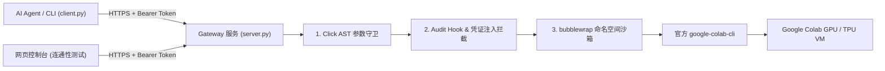

# ⚡ share-my-colab

> **把你的 Google Colab 高级算力安全分给家人与 AI Agent——同时把你的 Google 主账号锁在宿主机里。**

[](https://github.com/xuing/share-my-colab/actions/workflows/ci.yml)
[](LICENSE)

-success.svg)


**简体中文** | [English](README_EN.md)

零依赖的受控代理网关：将宿主机已登录的官方 `google-colab-cli`（`colab`）安全共享给受信任的家人、团队成员以及他们的 **AI Agent**，同时严格隔离宿主机的 Google 账号 OAuth 凭证、个人 Google Drive 与本地文件系统。

---

## 为什么做这个项目（Motivation）

Google Colab Pro / Pro+ / AI Ultra 订阅附带的算力单元（CCU）与高配 GPU（L4、G4、A100、H100 等）绑定在购买者的个人 Google 账号上，官方不支持将 Colab 算力原生共享给 Google 家庭组或团队成员。

如果直接把宿主机的 `~/.config/colab-cli/token.json` 分发给他人，等价于交出了包含 `cloud-platform` 等高危 OAuth scope 的账号凭证——持有者不仅能挂载你的个人 Google Drive，还能访问账号邮箱、GCP 项目及其他敏感隐私。

**`share-my-colab` 解决的正是这个问题：**

- **账号隐私不外泄**：所有 CLI 命令在宿主机受控沙箱内执行，客户端与远端 Colab VM 均无法拿到宿主机 OAuth token、个人 Drive 或主机 SSH 密钥。
- **专为 AI Agent 与 CLI 设计**：提供零依赖单文件客户端 [`client.py`](client.py) 与可直接加载的 Agent 技能文档 [`SKILL.md`](SKILL.md)，支持本地脚本/数据自动上传、结果文件与输出 Notebook 自动取回，以及结构化 `--json` 输出。
- **极简网页端定位**：内置网页控制台（`GET /`）仅用于**新用户接入指引、查看余额/运行中会话，以及执行一次性的连通性测试（Smoke Test）**；日常多文件开发、依赖安装与持久 GPU 调试请交由 AI Agent 或终端 `client.py` 完成。

---

## 架构概览



核心安全思路是**三道互相独立的纵深防线**（详见 [SECURITY.md](SECURITY.md)）：

1. **Click AST 参数守卫**：在 `colab` 自己的 Python 解释器中调用 `colab` 自身的 Click/Typer 解析器解析完全相同的 `argv`，彻底消除参数顺序、`--opt=val`、`-fVAL`、`--` 等解析差异绕过。
2. **Audit Hook 与运行时凭证拦截**：通过 `sys.addaudithook` 限制进程对 `$HOME` 的读写，并同时对 `ColabRuntime.colab_request_hook` 与 `colab_cli.commands.automation.get_credentials` 打补丁，阻断任何通过 `drive.mount()` 等路径向 VM 注入宿主机凭证的可能。
3. **`bubblewrap` 沙箱与专用 SSH 密钥**：将 `/home`、`/tmp`、`/mnt`、`/etc/ssh` 替换为空 `tmpfs`，仅挂回必要的 Python 环境、`~/.config/colab-cli`、专用 `.gateway_ssh` 密钥与本次任务临时目录；配合独立 PID/IPC 命名空间、`PYTHONSAFEPATH=1`、环境变量白名单与输出敏感词脱敏（`REDACTED`）。

---

## 仓库结构

| 文件 / 目录 | 说明 |
|---|---|
| [`server.py`](server.py) | 网关服务端（HTTP API、Web 引导页、三层安全守卫与沙箱调度，仅依赖 Python 标准库） |
| [`client.py`](client.py) | 零依赖单文件远程 CLI 客户端，支持文件自动暂存/取回与 `--json` 结构化输出 |
| [`SKILL.md`](SKILL.md) | 面向 AI Agent（Claude Code、Codex、Cursor、Antigravity 等）的即用型操作技能文件 |
| [`SECURITY.md`](SECURITY.md) | 威胁模型、三层纵深防御机制详解、非目标声明与生产加固清单 |
| `deploy/` | 生产部署模板：[`deploy/.env.example`](deploy/.env.example)、[`deploy/share-my-colab.service`](deploy/share-my-colab.service)、[`deploy/Caddyfile.example`](deploy/Caddyfile.example) |
| `tests/` | 零依赖单元测试与集成测试套件（[`tests/test_gateway.py`](tests/test_gateway.py)，不消耗 CCU） |
| [`README_EN.md`](README_EN.md) | 英文版项目说明文档 |
| [`LICENSE`](LICENSE) | MIT 开源许可证 |

---

## 开放与禁止的子命令

网关采用**严格白名单**策略（不采用黑名单），防止 `google-colab-cli` 升级引入的新命令或隐藏命令绕过限制。

| 类别 | 命令 / 参数 | 说明 |
|---|---|---|
| **开放的子命令（21 个）** | `download`、`exec`、`help`、`install`、`log`、`ls`、`new`、`readme`、`repl`、`restart-kernel`、`rm`、`run`、`sessions`、`skill`、`ssh`、`status`、`stop`、`upload`、`url`、`usage`、`version` | 另允许根级 `-h` / `--help`。其中 `ssh` 仅限非交互式单次命令（`ssh -s NAME -- CMD`），固定使用网关专用密钥，拒绝 `-i/--identity` 与代理模式；`url` 禁止 `--open`。 |
| **禁止：`auth`** | `colab auth` | 会将宿主机包含 `cloud-platform` 的 GCP 凭证注入远端 VM。 |
| **禁止：`drivemount`** | `colab drivemount` | 会将宿主机账号的个人 Google Drive 挂载到远端 VM。 |
| **禁止：`whoami`** | `colab whoami` | 会泄露宿主机 Google 账号邮箱及 OAuth token 的授权 scope。 |
| **禁止：`update`** | `colab update` | 会修改宿主机本地安装的 CLI 程序。 |
| **禁止：`edit` / `pay`** | `colab edit`、`colab pay` | 依赖宿主机本地交互式终端编辑器（`$EDITOR`）或浏览器。 |
| **禁止的全局参数** | `--auth`、`-c`、`--config`、`--logtostderr`、`--install-completion` 等 | 子命令前不允许携带任何全局参数（`-h`/`--help` 除外）；认证、配置与日志由网关统一管控。 |

此外，所有会读写宿主机本地路径的参数（`run` 脚本、`upload`/`download` 本地路径、`exec -f`、`--output-image`、`install -r`、`log -o`）在服务端均被限制在**本次任务的临时目录**内，session 名称必须匹配 `[A-Za-z0-9][A-Za-z0-9_.-]{0,63}`。

---

## 快速开始：宿主机管理员部署

### 1. 前置要求

- **操作系统**：Linux（生产环境强烈建议内核支持非特权 user namespace 以启用 `bubblewrap`）
- **Python**：3.10+（服务端与客户端均零第三方依赖）
- **官方 CLI**：宿主机已安装并登录 `google-colab-cli`（运行 `colab usage` 可正常返回余额）
- **可选系统工具**：
  - `bubblewrap`（`bwrap`）：启用第 3 层文件系统与 PID 隔离沙箱
  - `openssh-client`（`ssh-keygen`）：自动生成 `.gateway_ssh/id_ed25519` 以支持 `ssh` 子命令

### 2. 直接启动（验证与本地运行）

```bash
git clone https://github.com/xuing/share-my-colab.git /opt/share-my-colab
cd /opt/share-my-colab
python3 server.py
```

首次启动时会自动完成以下初始化：
- 在同目录生成权限为 `0600` 的随机密钥文件 `.gateway_token`（格式 `cgw_...`），也可通过环境变量 `COLAB_GW_TOKEN` 覆盖。
- 若系统存在 `ssh-keygen`，自动在 `.gateway_ssh/`（权限 `0700`）生成网关专用 `id_ed25519` 密钥对。
- 探测 `colab` 的 Python 解释器与 `bwrap` 沙箱可用性，默认监听 `http://127.0.0.1:8790`。

停止服务请发送 `SIGTERM`：网关会停止接收新请求，并等待正在执行的任务体面收尾（例如让 `run` 释放云端 VM），最多等待 `COLAB_GW_KILL_GRACE` 秒（默认 30 秒）。

### 3. 生产部署（`systemd` + `Caddy` HTTPS 反向代理）

仓库 `deploy/` 目录提供了开箱即用的生产配置模板：

```bash
# 1. 准备环境变量文件（deploy/.env.example 已默认 COLAB_GW_SANDBOX=bwrap，请按需配置并保护密钥）
cp deploy/.env.example .env
chmod 600 .env

# 2. 安装 systemd 服务（默认工作目录 /opt/share-my-colab；请将服务文件中的 User/Group 改为已登录 colab 的系统用户）
sudo cp deploy/share-my-colab.service /etc/systemd/system/
sudo systemctl daemon-reload
sudo systemctl enable --now share-my-colab
```

参考 [`deploy/Caddyfile.example`](deploy/Caddyfile.example) 通过 HTTPS 暴露子路径（如 `https://example.com/colab`）或独立域名（若 Caddy 运行在 Docker 容器中，上游请指向 `host.docker.internal:8790` 并做好宿主机防火墙隔离）：

```caddy
example.com {
	redir /colab /colab/ 308
	handle_path /colab/* {
		reverse_proxy 127.0.0.1:8790
	}
}
```

---

## 快速开始：AI Agent 与 CLI 用户

### 1. 下载客户端与 Agent Skill

直接从网关地址获取 [`client.py`](client.py) 与 [`SKILL.md`](SKILL.md)（无需额外安装任何包）：

```bash
curl -fO https://example.com/colab/client.py
curl -fO https://example.com/colab/SKILL.md
```

### 2. 一键交给 AI Agent（推荐主力用法）

将你的网关地址与管理员分发的密钥通过环境变量提供给终端/Agent 环境，然后把如下提示词发给 Claude Code、Codex、Cursor 或 Antigravity：

```text
请先下载并阅读 share-my-colab（受控 Colab 算力网关）的客户端与操作规范：
1. 下载 https://example.com/colab/client.py 和 https://example.com/colab/SKILL.md
2. 在运行命令前配置环境变量：
   export COLAB_GW_URL="https://example.com/colab"
   export COLAB_GW_TOKEN="<cgw_你的密钥>"
3. 严格按照 SKILL.md 使用 `python3 client.py --json ...` 操作远端 GPU：
   - 一次性脚本优先用 `run --gpu T4 script.py`（跑完自动释放）；
   - 需要持久会话时用 `-s <你的名字>-<任务名>` 命名，结束务必执行 `stop -s <会话名>`。
4. 先执行 `python3 client.py --json usage` 和 `python3 client.py --json sessions` 确认额度与当前机器状态。
```

### 3. 命令行常用示例

> [!IMPORTANT]
> 客户端选项（`--json`、`--timeout SEC`、`--url URL`）**必须写在子命令之前**，否则会被当作传给远端脚本或 `colab` 子命令的参数。

```bash
export COLAB_GW_URL="https://example.com/colab"
export COLAB_GW_TOKEN="cgw_你的密钥"   # 或写入 COLAB_GW_TOKEN_FILE / 同目录 .gateway_token

# 1. 查询算力余额与当前会话
python3 client.py usage
python3 client.py --json sessions

# 2. 一次性任务：开机 -> 运行 -> 取回产物 -> 自动释放 VM（最省额度）
python3 client.py run --gpu T4 train.py --epochs 3

# 3. 持久会话：持久 Jupyter kernel（变量在多次 exec 间保留，工作目录在 /content）
python3 client.py new -s alice-exp1 --gpu T4
python3 client.py install -s alice-exp1 -r requirements.txt
python3 client.py exec -s alice-exp1 -f train.py
echo 'print(model)' | python3 client.py exec -s alice-exp1
python3 client.py exec -s alice-exp1 -f notebook.ipynb       # 自动生成本地 notebook_output.ipynb
python3 client.py ssh -s alice-exp1 -- nvidia-smi </dev/null # Agent 中建议带 </dev/null
python3 client.py upload -s alice-exp1 data.csv /content/data.csv
python3 client.py download -s alice-exp1 /content/out.pt ./  # 目标为目录时沿用远端文件名
python3 client.py stop -s alice-exp1

# 4. 放宽单次网关执行超时 & 查看帮助
python3 client.py --timeout 3600 exec -s alice-exp1 -f long_train.py
python3 client.py --help
```

### 4. 本地文件自动暂存与退出码

- **自动上传**：`run <脚本>`、`upload <本地路径>`、`exec -f <文件>`、`install -r <requirements.txt>`。
- **自动回传**：`download` 目标路径、`exec`/`repl --output-image`、`log -o`、`exec -f x.ipynb` 产生的 `x_output.ipynb`；若 `exec` 产生图片但未指定 `--output-image`，图片会自动保存至当前目录的 `./colab_tmp/`。
- **退出码**：

| 退出码 | 含义 |
|---|---|
| `0` | 成功（或透传远端脚本 / `colab` / `ssh` 的退出码） |
| `1` | 网络异常、认证失败（401）、并发已满（429）或服务端 5xx 错误 |
| `2` | 客户端用法错误、本地文件不存在，或被网关策略/请求体上限拒绝（HTTP 400 / 403 / 413） |
| `124` | 超过网关运行时限（`--timeout` / `COLAB_GW_TIMEOUT`）被中断 |
| `130` | 客户端被 `Ctrl-C` 中断（注意：服务端上已启动的任务仍会继续运行直到结束或超时） |

---

## 环境变量配置

### 服务端（`server.py`）

| 环境变量 | 默认值 | 说明 |
|---|---|---|
| `COLAB_GW_HOST` | `127.0.0.1` | HTTP 监听地址 |
| `COLAB_GW_PORT` | `8790` | HTTP 监听端口 |
| `COLAB_GW_TOKEN` | 读取 `.gateway_token` | 网关 Bearer 密钥；未配置且文件不存在时首次启动自动创建（`0600`） |
| `COLAB_GW_SANDBOX` | `auto` | `auto`：探测可用即启用 `bwrap`；`bwrap`：不可用则拒绝启动；`off`：关闭沙箱 |
| `COLAB_GW_DEFAULT_TIMEOUT` | `600` | 单次命令默认最长运行时间（秒） |
| `COLAB_GW_MAX_TIMEOUT` | `3600` | 客户端可请求的单次最长运行时间上限（秒） |
| `COLAB_GW_MAX_CONCURRENT` | `4` | 最大并发执行任务数，超出返回 HTTP `429` |
| `COLAB_GW_MAX_BODY_BYTES` | `67108864`（64 MiB） | 单次请求体大小上限（含 base64 编码后的上传文件） |
| `COLAB_GW_MAX_RETURN_BYTES` | `67108864`（64 MiB） | 单次任务回传文件的累计原始大小上限 |
| `COLAB_GW_MAX_OUTPUT_BYTES` | `4194304`（4 MiB） | `stdout` 与 `stderr` 各自保留上限（超出时保留首尾各半并标记截断） |
| `COLAB_GW_MAX_WORKDIR_BYTES` | `1073741824`（1 GiB） | 单次任务临时工作目录磁盘上限，超出即中断 |
| `COLAB_GW_KILL_GRACE` | `30` | 超时或关闭时发送 `SIGINT` 后留给 `colab` 收尾（如释放 VM）的宽限秒数 |
| `COLAB_BIN` | 自动查找 | 官方 `colab` 可执行文件路径（默认查找 `PATH` 或 `~/.local/bin/colab`） |
| `COLAB_PYTHON` | 自动解析 | 运行 `colab` 的 Python 解释器路径（默认读取 `COLAB_BIN` 的 shebang） |

### 客户端（`client.py`）

| 环境变量 | 默认值 | 说明 |
|---|---|---|
| `COLAB_GW_URL` | `http://127.0.0.1:8790` | 网关基础 URL（如 `https://example.com/colab`） |
| `COLAB_GW_TOKEN` | — | 网关访问密钥 `cgw_...`（优先级最高） |
| `COLAB_GW_TOKEN_FILE` | — | 存放网关密钥的文件路径；若两者均未设置则回退读取 `client.py` 同目录的 `.gateway_token` |
| `COLAB_GW_TIMEOUT` | `600` | 单次命令在网关上的最长等待秒数 |
| `COLAB_GW_JSON` | — | 设为 `1` 时默认以结构化 JSON 输出结果（等价于传入 `--json`） |

---

## HTTP API 摘要

除 `/`、`/index.html`、`/client.py`、`/SKILL.md` 和 `/api/health` 外，所有接口都必须在请求头携带 `Authorization: Bearer <网关密钥>`。

| 方法与路径 | 鉴权 | 说明 |
|---|---|---|
| `GET /`、`GET /index.html` | 无 | 轻量级网页控制台（入驻引导、余额/会话查看与连通性测试，附带严格 CSP 响应头） |
| `GET /client.py` | 无 | 下载零依赖客户端 `client.py` |
| `GET /SKILL.md` | 无 | 下载 AI Agent 技能规范文件 `SKILL.md`（存在时提供） |
| `GET /api/health` | 无 | 返回服务状态（`"service": "share-my-colab"`）、`colab_cli_version`、`sandbox`（`bwrap` / `none`）、开放命令列表与各项配额上限 |
| `GET /api/usage` | Bearer | 执行 `colab usage` 并解析返回 `balance_ccu`、`usage_rate_per_hr`、`active_assignments` 与 `raw` |
| `GET /api/skill` | Bearer | 执行官方 `colab skill` 并返回原始结果 JSON |
| `POST /api/cli` | Bearer | 通用执行接口：`{"args": [...], "files": {"相对路径": "base64"}, "stdin_b64": "...", "timeout": 600}`，返回 `ok`、`exit_code`、`timed_out`、`stdout`、`stderr`、`files`、`stdout_b64`（二进制时）、`skipped_files` 等；策略拒绝返回 HTTP `403` |
| `POST /api/run` | Bearer | 网页端一次性运行接口：`{"code": "...", "gpu": "T4", "high_mem": false, "timeout": 600}`（支持 `CPU`/`T4`/`L4`/`G4`/`A100`/`H100`，自动命名会话并在跑完后释放） |

---

## 已知限制与共享算力池礼仪

1. **共享算力池与可见性**：所有持有密钥的成员共享宿主机上的同一个 Google Colab 账号。彼此可以通过 `sessions` 看到所有活跃机器，通过 `log` 读到会话历史（含代码与输出），也可以 `stop` 对方的会话。因此**创建持久会话请务必加上个人前缀**（如 `-s alice-train`），用完立即 `stop`，避免误停他人任务或浪费共享 CCU。
2. **断网/中断后任务仍会继续**：客户端按 `Ctrl-C` 或本地连接断开后，宿主机上已启动的 `colab` 任务会继续运行直到结束或达到服务端超时。
3. **超时后的远端 Kernel 恢复**：`exec` 或 `repl` 因超时被中断后，远端 Jupyter kernel 里可能仍在跑刚才那段代码，导致下一次 `exec` 排队卡住。若需立即复用该会话，请先执行 `python3 client.py restart-kernel -s <会话名>`（会清空内存中的变量）。
4. **`run` 在申请 VM 瞬间被中断**：极少数情况下，若 `run` 恰好在刚向 Colab 请求分配机器但尚未本地落盘记录的窗口期被中断，`sessions` 里可能出现 `[?]` 条目，通常只能等待 Colab 自动回收或在网页端手动停止。
5. **会话历史日志体积**：`google-colab-cli` 会将每次执行的代码与输出追加到宿主机 `~/.config/colab-cli/history/<session>.jsonl`，该目录不受单次任务 1 GiB 临时目录上限约束。若长期运行大量打印日志的任务，管理员需定期清理该目录。
6. **64 MiB 载荷上限**：上传与回传均经过 JSON/base64 编码，默认单次请求与回传上限均为 64 MiB（考虑约 33% 的 base64 膨胀，原始上传文件建议不超过 ~48 MiB）。大数据集与大型权重请直接在 VM 上拉取：
   ```bash
   python3 client.py ssh -s <会话名> -- wget -q -O /content/data.tar.gz "https://..." </dev/null
   ```
7. **升级 `google-colab-cli`**：升级上游 CLI 后，新增子命令必须经过安全评估并显式加入 `server.py` 的 `ALLOWED_COMMANDS` 才能放行；新增会读写本地路径的参数需加入 `LOCAL_PATH_PARAMS`（在未加入前，第 2、3 层防线仍会阻止其越出任务临时目录）。
