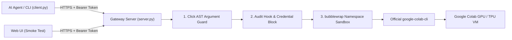

# ⚡ share-my-colab

> **Share your Google Colab GPUs with family, friends & AI agents — without handing over your Google account.**

[](https://github.com/xuing/share-my-colab/actions/workflows/ci.yml)
[](LICENSE)

-success.svg)


[简体中文](README.md) | **English**

A zero-dependency, security-hardened proxy gateway that exposes a host's authenticated `google-colab-cli` (`colab`) to trusted family members, collaborators, and primarily their **AI Agents**—without leaking the host's Google account OAuth credentials, personal Google Drive, or local filesystem.

---

## Motivation

Google Colab Pro / Pro+ / AI Ultra subscriptions tie compute units (CCU) and high-end GPUs (L4, G4, A100, H100, etc.) strictly to the purchaser's personal Google account. Google provides no native way to share a Colab quota or GPU allocation across a Google Family group or research team.

Handing out `~/.config/colab-cli/token.json` directly is unsafe: that OAuth token carries high-privilege scopes (such as `cloud-platform`), granting recipients access to your personal Google Drive, account email, and linked GCP resources.

**`share-my-colab` solves this cleanly:**

- **Strict Credential & Host Isolation**: Every `colab` command runs inside a locked-down sandbox on the host. Neither remote callers nor Colab VMs can read the host's OAuth credentials, personal Google Drive, host SSH keys, or `$HOME` files.
- **Built for AI Agents & CLI Workflows**: Ships with a zero-dependency single-file client ([`client.py`](client.py)) and a drop-in Agent skill specification ([`SKILL.md`](SKILL.md)) supporting automatic local file upload/retrieval, notebook output capture, and structured `--json` responses.
- **Minimal Web UI Scope**: The built-in webpage (`GET /`) is intentionally lightweight—meant only for onboarding instructions, checking CCU balance/active sessions, and running a quick smoke test. Daily multi-file workflows belong in AI Agents or the `client.py` CLI.

---

## Architecture



Security rests on **three independent defense layers** (see [SECURITY.md](SECURITY.md) for the full threat model and implementation details):

1. **Click AST Argument Guard**: Runs inside `colab`'s own Python interpreter and parses `argv` using `colab`'s exact Click/Typer command parser before invoking `main()` in the same process—eliminating parser-differential bypasses (flag order, `--opt=val`, `-fVAL`, `--`).
2. **Audit Hook & Runtime Credential Block**: Registers a `sys.addaudithook` restricting writes and hiding `$HOME` outside allowed paths, while monkeypatching both `ColabRuntime.colab_request_hook` and `colab_cli.commands.automation.get_credentials` to prevent credential propagation (e.g., via `drive.mount()`).
3. **`bubblewrap` Sandbox & Dedicated SSH Key**: Masks `/home`, `/tmp`, `/mnt`, and `/etc/ssh` with empty `tmpfs` mounts, exposing only Python/colab read roots, `~/.config/colab-cli`, a dedicated `.gateway_ssh` Ed25519 key, and the per-job scratch directory inside isolated PID/IPC namespaces—paired with `PYTHONSAFEPATH=1`, an environment variable whitelist, and automatic secret redaction (`REDACTED`).

---

## Repository Layout

| Path | Description |
|---|---|
| [`server.py`](server.py) | Gateway HTTP server, Web UI, 3-layer security guard, and sandbox runner (Python stdlib only) |
| [`client.py`](client.py) | Zero-dependency single-file CLI client with automatic file staging/retrieval and `--json` mode |
| [`SKILL.md`](SKILL.md) | Ready-to-use skill specification for AI Agents (Claude Code, Codex, Cursor, Antigravity, etc.) |
| [`SECURITY.md`](SECURITY.md) | Threat model, 3-layer defense breakdown, explicit non-goals, and production hardening checklist |
| `deploy/` | Production templates: [`deploy/.env.example`](deploy/.env.example), [`deploy/share-my-colab.service`](deploy/share-my-colab.service), [`deploy/Caddyfile.example`](deploy/Caddyfile.example) |
| `tests/` | Zero-dependency unit & integration test suite ([`tests/test_gateway.py`](tests/test_gateway.py), spends 0 CCU) |
| [`README.md`](README.md) | Chinese documentation |
| [`LICENSE`](LICENSE) | MIT License |

---

## Allowed vs. Blocked Commands

The gateway enforces a **strict subcommand allowlist** rather than a blocklist so future `google-colab-cli` upgrades or hidden commands cannot slip through.

| Category | Command / Flag | Notes |
|---|---|---|
| **Allowed Subcommands (21)** | `download`, `exec`, `help`, `install`, `log`, `ls`, `new`, `readme`, `repl`, `restart-kernel`, `rm`, `run`, `sessions`, `skill`, `ssh`, `status`, `stop`, `upload`, `url`, `usage`, `version` | Root `-h` / `--help` is also allowed. `ssh` only permits non-interactive single commands (`ssh -s NAME -- CMD`), pins the gateway's dedicated key, and rejects `-i/--identity` and proxy/ssh modes; `url` forbids `--open`. |
| **Blocked: `auth`** | `colab auth` | Injects the host's GCP credentials (`cloud-platform`) into the remote VM. |
| **Blocked: `drivemount`** | `colab drivemount` | Mounts the host Google account's personal Google Drive inside the VM. |
| **Blocked: `whoami`** | `colab whoami` | Exposes the host account email and OAuth token scopes. |
| **Blocked: `update`** | `colab update` | Modifies the installed CLI package on the host. |
| **Blocked: `edit` / `pay`** | `colab edit`, `colab pay` | Requires an interactive host `$EDITOR` or local web browser. |
| **Blocked Global Flags** | `--auth`, `-c`, `--config`, `--logtostderr`, `--install-completion`, etc. | No global flags (except `-h`/`--help`) are accepted before the subcommand; auth, config, and logging are managed exclusively by the gateway. |

All parameters that read or write host files (`run` script, `upload`/`download` local paths, `exec -f`, `--output-image`, `install -r`, `log -o`) are constrained to the ephemeral per-job working directory, and session names must match `[A-Za-z0-9][A-Za-z0-9_.-]{0,63}`.

---

## Quick Start: Host Admin

### 1. Prerequisites

- **OS**: Linux (with unprivileged user namespaces enabled for `bubblewrap` in production)
- **Python**: 3.10+ (zero external Python dependencies required)
- **Authenticated CLI**: `google-colab-cli` installed and logged in on the host (`colab usage` returns your CCU balance)
- **Recommended System Tools**:
  - `bubblewrap` (`bwrap`) for Layer 3 filesystem & PID namespace isolation
  - `openssh-client` (`ssh-keygen`) so the gateway can auto-generate `.gateway_ssh/id_ed25519` for `ssh`

### 2. Direct Startup (Local Test / Foreground)

```bash
git clone https://github.com/xuing/share-my-colab.git /opt/share-my-colab
cd /opt/share-my-colab
python3 server.py
```

On first launch, `server.py`:
- Generates `.gateway_token` (`0600`, prefixed with `cgw_`) unless `COLAB_GW_TOKEN` is already set.
- Generates a dedicated `.gateway_ssh/id_ed25519` keypair (`0700` directory) if `ssh-keygen` is available.
- Probes `colab`'s Python environment and `bwrap` availability, then listens on `http://127.0.0.1:8790`.

Send `SIGTERM` for graceful shutdown: the gateway stops accepting new requests and waits up to `COLAB_GW_KILL_GRACE` seconds (default `30`) for active jobs to finish cleanup (e.g., `run` releasing its VM).

### 3. Production Deployment (`systemd` + `Caddy`)

Templates live under `deploy/`:

```bash
# 1. Create environment file (deploy/.env.example defaults COLAB_GW_SANDBOX=bwrap; adjust and protect your token)
cp deploy/.env.example .env
chmod 600 .env

# 2. Install systemd service (defaults to /opt/share-my-colab; set User/Group to the host user owning ~/.config/colab-cli)
sudo cp deploy/share-my-colab.service /etc/systemd/system/
sudo systemctl daemon-reload
sudo systemctl enable --now share-my-colab
```

Use [`deploy/Caddyfile.example`](deploy/Caddyfile.example) to terminate HTTPS either on a subpath (`https://example.com/colab`) or a dedicated subdomain (if Caddy runs inside Docker, point `reverse_proxy` to `host.docker.internal:8790` and restrict host bridge access via firewall):

```caddy
example.com {
	redir /colab /colab/ 308
	handle_path /colab/* {
		reverse_proxy 127.0.0.1:8790
	}
}
```

---

## Quick Start: AI Agents & CLI Users

### 1. Download Client & Agent Skill

```bash
curl -fO https://example.com/colab/client.py
curl -fO https://example.com/colab/SKILL.md
```

### 2. Ready-to-Use AI Agent Prompt

Set `COLAB_GW_URL` and `COLAB_GW_TOKEN` in the shell environment, then hand this prompt to Claude Code, Codex, Cursor, or Antigravity:

```text
Download and follow the share-my-colab (remote Colab gateway) client and skill instructions:
1. Download https://example.com/colab/client.py and https://example.com/colab/SKILL.md
2. Configure the environment before running commands:
   export COLAB_GW_URL="https://example.com/colab"
   export COLAB_GW_TOKEN="<cgw_your_token>"
3. Follow SKILL.md strictly and use `python3 client.py --json ...` to operate remote GPUs:
   - Prefer `run --gpu T4 script.py` for one-shot tasks (auto-provisions and releases the VM).
   - For persistent sessions, prefix session names with `-s <your-name>-<task>` and always run `stop -s <session>` when finished.
4. Start by running `python3 client.py --json usage` and `python3 client.py --json sessions`.
```

### 3. CLI Examples

> [!IMPORTANT]
> Client options (`--json`, `--timeout SEC`, `--url URL`) **must appear before** the subcommand so they are not forwarded to remote scripts or `colab`.

```bash
export COLAB_GW_URL="https://example.com/colab"
export COLAB_GW_TOKEN="cgw_your_token"   # or use COLAB_GW_TOKEN_FILE / local .gateway_token

# 1. Check shared CCU quota and active sessions
python3 client.py usage
python3 client.py --json sessions

# 2. One-shot job: provision -> run -> retrieve artifacts -> auto-release VM
python3 client.py run --gpu T4 train.py --epochs 3

# 3. Persistent session (Jupyter kernel state persists across exec calls; VM cwd is /content)
python3 client.py new -s alice-exp1 --gpu T4
python3 client.py install -s alice-exp1 -r requirements.txt
python3 client.py exec -s alice-exp1 -f train.py
echo 'print(model)' | python3 client.py exec -s alice-exp1
python3 client.py exec -s alice-exp1 -f notebook.ipynb        # saves local notebook_output.ipynb
python3 client.py ssh -s alice-exp1 -- nvidia-smi </dev/null  # recommended </dev/null for Agents
python3 client.py upload -s alice-exp1 data.csv /content/data.csv
python3 client.py download -s alice-exp1 /content/out.pt ./   # directory targets keep remote filename
python3 client.py stop -s alice-exp1

# 4. Override per-command timeout & view full help
python3 client.py --timeout 3600 exec -s alice-exp1 -f long_train.py
python3 client.py --help
```

### 4. Automatic File Staging & Exit Codes

- **Auto-uploaded inputs**: `run <script>`, `upload <local_path>`, `exec -f <file>`, `install -r <requirements.txt>`.
- **Auto-retrieved outputs**: `download` destination, `exec`/`repl --output-image`, `log -o`, `<stem>_output.ipynb` generated by `exec -f <stem>.ipynb`, plus any images produced by `exec` without `--output-image` (saved under `./colab_tmp/`).
- **Exit codes**:

| Exit Code | Meaning |
|---|---|
| `0` | Success (or forwarded exit code from remote script / `colab` / `ssh`) |
| `1` | Network failure, auth error (`401`), concurrency limit (`429`), or gateway `5xx` error |
| `2` | Client usage error, missing local file, or gateway policy/size rejection (`400` / `403` / `413`) |
| `124` | Execution timed out on the gateway (`--timeout` / `COLAB_GW_TIMEOUT`) |
| `130` | Interrupted locally via `Ctrl-C` (the remote job on the gateway continues until completion or timeout) |

---

## Configuration Environment Variables

### Server (`server.py`)

| Variable | Default | Description |
|---|---|---|
| `COLAB_GW_HOST` | `127.0.0.1` | Bind address |
| `COLAB_GW_PORT` | `8790` | Listen port |
| `COLAB_GW_TOKEN` | Reads `.gateway_token` | Bearer token; auto-generated (`0600`) on first start if unset and file missing |
| `COLAB_GW_SANDBOX` | `auto` | `auto`: use `bwrap` if available; `bwrap`: fail startup if unavailable; `off`: disable sandbox |
| `COLAB_GW_DEFAULT_TIMEOUT` | `600` | Default per-job timeout in seconds |
| `COLAB_GW_MAX_TIMEOUT` | `3600` | Maximum allowed per-job timeout in seconds |
| `COLAB_GW_MAX_CONCURRENT` | `4` | Maximum concurrent running jobs; excess requests get HTTP `429` |
| `COLAB_GW_MAX_BODY_BYTES` | `67108864` (64 MiB) | Maximum request body size (including base64-encoded uploads) |
| `COLAB_GW_MAX_RETURN_BYTES` | `67108864` (64 MiB) | Maximum cumulative raw bytes of returned files per job |
| `COLAB_GW_MAX_OUTPUT_BYTES` | `4194304` (4 MiB) | Per-stream cap for `stdout` and `stderr` (retains first/last halves on overflow) |
| `COLAB_GW_MAX_WORKDIR_BYTES` | `1073741824` (1 GiB) | Per-job scratch directory disk cap; aborts job if exceeded |
| `COLAB_GW_KILL_GRACE` | `30` | Grace period in seconds after `SIGINT` for `colab` cleanup (e.g., releasing VMs) |
| `COLAB_BIN` | Auto-detected | Path to the `colab` executable (searches `PATH` or `~/.local/bin/colab`) |
| `COLAB_PYTHON` | Auto-detected | Python interpreter for `colab` (parsed from `COLAB_BIN` shebang) |

### Client (`client.py`)

| Variable | Default | Description |
|---|---|---|
| `COLAB_GW_URL` | `http://127.0.0.1:8790` | Gateway base URL (e.g., `https://example.com/colab`) |
| `COLAB_GW_TOKEN` | — | Gateway bearer token `cgw_...` (highest priority) |
| `COLAB_GW_TOKEN_FILE` | — | File path containing token; falls back to `.gateway_token` next to `client.py` |
| `COLAB_GW_TIMEOUT` | `600` | Default client timeout in seconds |
| `COLAB_GW_JSON` | — | Set to `1` to output structured JSON by default (equivalent to `--json`) |

---

## HTTP API Summary

All endpoints except `/`, `/index.html`, `/client.py`, `/SKILL.md`, and `/api/health` require `Authorization: Bearer <token>`.

| Method & Path | Auth | Description |
|---|---|---|
| `GET /`, `GET /index.html` | None | Lightweight Web UI for onboarding, quota checks, and smoke tests (served with strict CSP) |
| `GET /client.py` | None | Downloads the zero-dependency `client.py` CLI |
| `GET /SKILL.md` | None | Downloads the AI Agent skill document `SKILL.md` (when present) |
| `GET /api/health` | None | Returns gateway status (`"service": "share-my-colab"`), `colab_cli_version`, `sandbox` mode (`bwrap`/`none`), allowed `commands`, and `limits` |
| `GET /api/usage` | Bearer | Runs `colab usage` and returns parsed `balance_ccu`, `usage_rate_per_hr`, `active_assignments`, and `raw` |
| `GET /api/skill` | Bearer | Runs upstream `colab skill` and returns raw JSON output |
| `POST /api/cli` | Bearer | Runs an allowed CLI command: `{"args": [...], "files": {"rel/path": "base64"}, "stdin_b64": "...", "timeout": 600}`; returns `ok`, `exit_code`, `timed_out`, `stdout`, `stderr`, `files`, optional `stdout_b64`, `skipped_files` (`403` on policy denial) |
| `POST /api/run` | Bearer | One-shot runner for the Web UI: `{"code": "...", "gpu": "T4", "high_mem": false, "timeout": 600}` (`CPU`/`T4`/`L4`/`G4`/`A100`/`H100`; auto-assigns session and releases VM after run) |

---

## Known Limitations & Shared Pool Etiquette

1. **Shared Compute Pool Visibility**: All token holders share the same host Colab account. Everyone can inspect `sessions`, read session `log` history (code and outputs), and `stop` any active session. **Always prefix persistent session names** with your identifier (e.g., `-s alice-train`, matching `[A-Za-z0-9][A-Za-z0-9_.-]{0,63}`) and `stop` them immediately when finished.
2. **Disconnects Do Not Cancel Remote Jobs**: Pressing `Ctrl-C` locally or dropping the network connection leaves the already-started `colab` job running on the gateway until completion or timeout.
3. **Post-Timeout Kernel Recovery**: After an `exec` or `repl` timeout, the remote Jupyter kernel may still be busy running the interrupted cell, blocking subsequent `exec` calls. Run `python3 client.py restart-kernel -s <session>` (clears in-memory kernel variables) before reusing that session.
4. **Ghost `[?]` Sessions on Early Abort**: If `run` is interrupted in the brief window while requesting a VM before local state is saved, `sessions` may display `[?]`; wait for Colab auto-reclaim or stop it in the Colab web UI.
5. **History Log Growth**: `google-colab-cli` appends executed code and outputs to `~/.config/colab-cli/history/<session>.jsonl` outside the 1 GiB per-job scratch cap. Admins should periodically prune old history files after noisy runs.
6. **64 MiB JSON/Base64 Payload Cap**: Request bodies and returned files default to 64 MiB (base64 encoding adds ~33%, so raw uploads top out around ~48 MiB). Download large datasets directly onto the VM:
   ```bash
   python3 client.py ssh -s <session> -- wget -q -O /content/data.tar.gz "https://..." </dev/null
   ```
7. **Upgrading `google-colab-cli`**: New upstream subcommands stay blocked until reviewed and added to `ALLOWED_COMMANDS` in `server.py`; new local file options should be mapped in `LOCAL_PATH_PARAMS` (until mapped, Layers 2 and 3 still block access outside the job directory).
